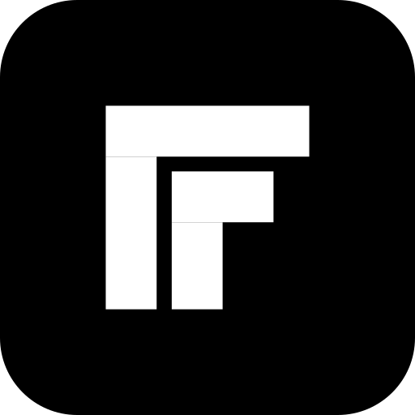
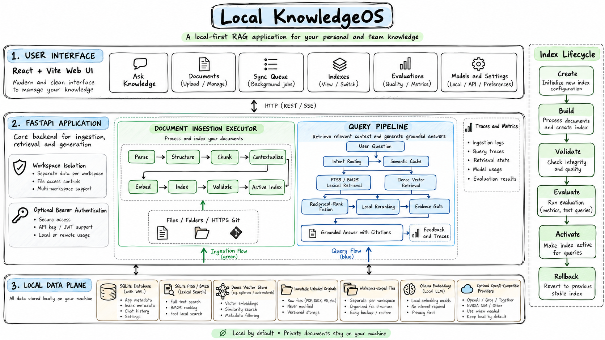
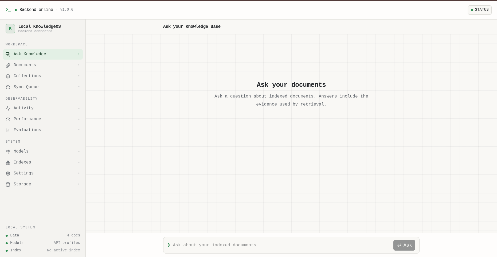
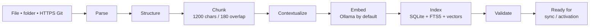
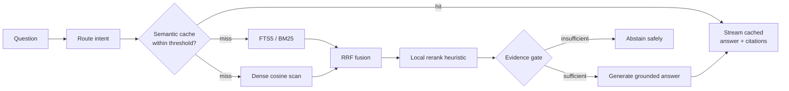

<div align="center">

<div style="margin: 20px 0;">
  
</div>

# 🚀 Local KnowledgeOS: Private, Local-First RAG Workspace

<p align="center">
  <em>Ingest private knowledge. Build inspectable indexes. Ask grounded questions with citations.</em>
</p>

<div align="center" style="margin: 30px 0;">
  
</div>

<div align="center">
  <div style="width: 100%; height: 2px; margin: 20px 0; background: linear-gradient(90deg, transparent, #4f9361, transparent);"></div>
</div>

<div align="center">
  <div style="background: linear-gradient(135deg, #edf7ef 0%, #eef3f8 100%); border-radius: 15px; padding: 25px; text-align: center;">
    <p>
      <a href="https://github.com/venkatkollu/LocalKnowledge"></a>
      <a href="architecture.png"></a>
      <a href="./docs/screenshotask-knowledge-user.png"></a>
    </p>
    <p>
      
      
      
    </p>
    <p>
      
      
      
    </p>
  </div>
</div>

</div>

> Local KnowledgeOS is a self-hosted knowledge workspace for indexing private documents and asking evidence-backed questions. Originals, metadata, lexical search, vectors, traces, and answer cache stay local by default; remote OpenAI-compatible providers are optional.

---

## 🎉 Highlights

- **Local document ingestion** for Markdown, text, PDF, source code, JSON, YAML, CSV, SQL, HTML, CSS, XML, logs, local folders, and shallow HTTPS Git clones.
- **Hybrid retrieval** combining SQLite FTS5/BM25, dense cosine similarity, reciprocal-rank fusion, and a local reranking heuristic.
- **Grounded streaming answers** with citations, evidence-quality metadata, trace IDs, and thumbs-up/down feedback.
- **Inspectable chunking** with configurable chunk size and overlap, line ranges, token counts, SHA-256 deduplication, and version history.
- **Blue-green indexes** that can be created, built, validated, evaluated, activated, and rolled back without interrupting the active revision.
- **Local embeddings** through Ollama (`all-minilm` by default), with optional OpenAI-compatible embedding or generation profiles.
- **Evaluation and observability** with Recall@100, nDCG@10, MRR@10, traces, latency percentiles, stage timings, query outcomes, and storage metrics.
- **Workspace isolation** on every persistent row, optional bearer authentication, encrypted provider keys, and a Docker Compose deployment.

## 🖥️ Product preview

<div align="center">
<table>
<tr>
<td align="center" width="50%"><strong>Ask Knowledge</strong><br></td>
<td align="center" width="50%"><strong>Workspace dashboard</strong><br></td>
</tr>
<tr>
</tr>
</table>
</div>

## 📰 Project status

- **Current:** Local-first ingestion, hybrid retrieval, streaming answers, workspace-scoped storage, and index lifecycle management are implemented.
- **Runtime:** The frontend builds successfully with Vite; the FastAPI health endpoint reports SQLite/FTS5 availability and the configured embedding provider.
- **Embedding modes:** Ollama is the default path. A deterministic hash fallback is available only for isolated offline smoke tests.
- **Deployment:** Docker Compose includes the web UI, API, and Ollama model service, with an optional NVIDIA GPU override.

<details>
  <summary><strong>🔄 Ingestion flow</strong></summary>



Each job exposes stage progress across parsing, structure, chunking, contextualizing, embedding, indexing, and validation. Changed files are deduplicated by SHA-256 and stored as new document versions.

</details>

<details>
  <summary><strong>🔎 Query and answer flow</strong></summary>



The evidence gate can abstain when retrieved context is too weak. Successful answers stream citations and persist trace metadata for inspection and feedback.

</details>

<details>
  <summary><strong>📚 Index lifecycle</strong></summary>

```text
create → build → validate → evaluate → activate
                                  └── failed gate: remain inactive
active → rollback → previous validated revision
```

Candidate revisions are evaluated before activation. The active revision remains isolated so a build or rollback does not interrupt current queries.

</details>

## 🧭 Table of Contents

- [Installation](#-installation)
  - [Docker Compose](#docker-compose-recommended)
  - [Local development](#local-development)
  - [Offline smoke test](#offline-smoke-test)
- [Usage](#-usage)
- [Architecture](#-architecture)
- [Configuration](#-configuration)
- [Repository structure](#-repository-structure)
- [Development checks](#-development-checks)
- [Security notes](#-security-notes)
- [License](#-license)

## 📦 Installation

### Docker Compose (recommended)

Requirements: Docker Engine with the Compose plugin.

```bash
cp .env.docker.example .env
docker compose up --build -d
```

Open [http://localhost:8080](http://localhost:8080). The first start pulls the configured embedding model into the `ollama-models` volume.

```bash
# Check service health
docker compose ps

# Follow model and API startup
docker compose logs -f ollama-pull backend

# Stop services but preserve data and models
docker compose down

# Remove services, data, and model volumes
docker compose down -v
```

For NVIDIA GPU inference:

```bash
docker compose -f docker-compose.yml -f docker-compose.gpu.yml up --build -d
```

### Local development

Requirements: Node.js 22+, npm, Python 3.11+, and Ollama for local embeddings.

```bash
# Terminal 1 — backend
python3 -m venv .venv
. .venv/bin/activate
pip install -r backend/requirements.txt
sh backend/setup_ollama.sh
./backend/run.sh

# Terminal 2 — frontend
npm install
npm run dev
```

Open [http://localhost:5173](http://localhost:5173). Vite proxies `/api` to `http://127.0.0.1:8000`.

### Offline smoke test

Use the deterministic hash embedding fallback when Ollama is not available. It is intended for tests and local UI verification, not production retrieval quality.

```bash
KNOWLEDGEOS_ALLOW_HASH_EMBEDDING_FALLBACK=true \
KNOWLEDGEOS_OLLAMA_AUTO_START=false \
KNOWLEDGEOS_OLLAMA_AUTO_PULL=false \
./backend/run.sh
```

## 🚀 Usage

1. Open **Documents** and add files, a local folder, or a shallow HTTPS Git repository.
2. Watch the sync queue as content moves through parsing, chunking, embedding, indexing, and validation.
3. Open **Indexes** to create and build a candidate revision, then validate and activate it.
4. Ask a question from **Ask Knowledge**. Answers stream with citations and evidence metadata.
5. Use **Activity**, **Performance**, and **Evaluations** to inspect traces, latency, retrieval quality, and feedback.
6. Configure local or OpenAI-compatible generation and embedding providers from **Models**.

## 🏗️ Architecture

The hand-drawn architecture diagram at the top of this README is the primary visual. An editable Mermaid reference is also available at [`docs/architecture.mmd`](./docs/architecture.mmd).

### Frontend

The React/Vite application provides the workspace shell, chat experience, document grid, sync progress, index lifecycle screens, model profiles, telemetry views, and responsive navigation. Typed API clients live under [`src/api`](./src/api).

<div align="center">
  <p><strong>Ask Knowledge UI</strong></p>
  
</div>

### Backend

The FastAPI service in [`backend/main.py`](./backend/main.py) owns authentication, workspace resolution, ingestion jobs, parsing, chunking, embeddings, FTS5 indexing, dense retrieval, semantic cache, streaming answers, traces, feedback, metrics, and index lifecycle operations.

### Local data plane

SQLite runs in WAL mode and stores metadata, jobs, chunks, FTS5 records, vectors, traces, cache entries, and index revisions. Immutable uploaded or synchronized originals live under `data/files/<workspace>`. The adapter boundary leaves room for PostgreSQL, pgvector/Qdrant, S3/MinIO, or Redis in a larger deployment.

## ⚙️ Configuration

| Variable | Default | Purpose |
| --- | --- | --- |
| `KNOWLEDGEOS_DATA_DIR` | `data` | SQLite database, originals, and generated secrets |
| `KNOWLEDGEOS_OLLAMA_BASE_URL` | `http://127.0.0.1:11434` | Ollama endpoint |
| `KNOWLEDGEOS_OLLAMA_EMBEDDING_MODEL` | `all-minilm` | Local embedding model |
| `KNOWLEDGEOS_WORKERS` | `4` | Ingestion thread-pool size |
| `KNOWLEDGEOS_ALLOW_ANONYMOUS` | `true` | Allow local requests without bearer auth |
| `KNOWLEDGEOS_AUTH_SECRET` | local development secret | HMAC key for bearer tokens |
| `KNOWLEDGEOS_ENCRYPTION_KEY` | derived from auth secret | Fernet key for provider API keys |
| `KNOWLEDGEOS_CHUNK_SIZE` | `1200` | Target chunk size in characters |
| `KNOWLEDGEOS_CHUNK_OVERLAP` | `180` | Overlap between adjacent chunks |
| `VITE_KNOWLEDGEOS_API_URL` | empty | Optional frontend API origin |

See [`.env.example`](./.env.example) and [`.env.docker.example`](./.env.docker.example) for the full configuration surface.

## 🗂️ Repository structure

```text
.
├── backend/
│   ├── main.py                 # FastAPI app and local RAG engine
│   ├── requirements.txt        # Python dependencies
│   └── run.sh                  # Backend launcher
├── src/
│   ├── api/                    # Typed API clients and domain types
│   ├── components/             # Chat, documents, indexes, shell, and UI primitives
│   ├── pages/                  # Workspace routes
│   └── hooks/                  # Health, documents, auth, and telemetry
├── docs/
│   ├── architecture.mmd       # Editable text-based architecture reference
│   ├── architecture.png       # Primary hand-drawn architecture visual
│   └── screenshots/            # Runtime UI screenshots
├── docker-compose.yml          # CPU Compose stack
└── docker-compose.gpu.yml      # Optional NVIDIA GPU override
```

## 🧪 Development checks

```bash
npm run build
npm run lint
python3 -m py_compile backend/main.py
python3 backend/check_dependencies.py
```

The production frontend build passes. ESLint currently reports only existing React Fast Refresh export warnings in shared UI modules; there are no lint errors.

## 🔒 Security notes

- Set `KNOWLEDGEOS_ALLOW_ANONYMOUS=false` and a strong `KNOWLEDGEOS_AUTH_SECRET` outside local development.
- Set and back up an explicit `KNOWLEDGEOS_ENCRYPTION_KEY`; changing it makes stored provider keys undecryptable.
- Keep the API behind TLS and a private network when exposing the UI beyond localhost.
- Restrict `KNOWLEDGEOS_CORS_ORIGINS` to the real frontend origin.
- Do not commit `.env`, `data/`, SQLite files, generated secrets, or provider keys.
- Keep `KNOWLEDGEOS_ALLOW_HASH_EMBEDDING_FALLBACK=false` in production.

## 📄 License

See the repository for the current license and contribution terms.